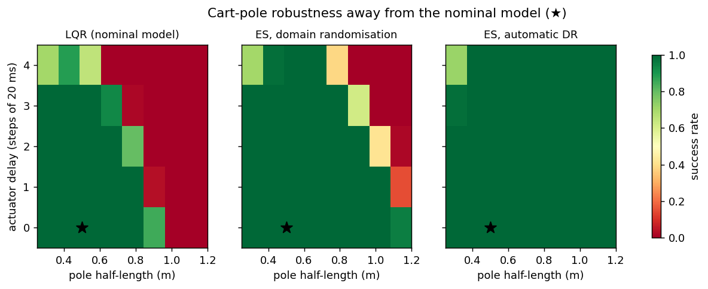

# sim2real-randomization

How do you train a robot controller in simulation so that it still works on the real machine, where masses, delays, motor responses and disturbances are never what the model says? This repo compares the standard answers head to head on two robots: a **cart-pole** and a **planar quadrotor (VTOL)**.

| Strategy | Idea |
|---|---|
| LQR on the nominal model | Optimal control for the model you believe in |
| ES, nominal sim | Policy search in the nominal simulator |
| **Domain randomisation (DR)** | Policy search over a hand-chosen range of plausible plants |
| **Automatic DR (ADR)** | Start from the nominal plant and widen each parameter's range only while the policy keeps succeeding at the boundary ([OpenAI et al., 2019](https://arxiv.org/abs/1910.07113)) |
| **System identification + fine-tuning** | Run a few safe test episodes on the real plant, fit the simulator's parameters (including the integer actuator delay) to the logs, then fine-tune in a narrow range around the estimate |
 
The "reality gap" is modelled with the usual suspects:
- masses and geometry
- actuator gain, **delay** and rotor **lag**
- friction
- sensor noise
- pushes and wind gusts

The "real" robots are 1,000 plants drawn from a wider *reality* distribution than the hand-chosen DR range, because in practice you never guess the range right.

## Results

```bash
pip install -e ".[dev]"
python examples/run_study.py          # ~12 min on a laptop CPU (--quick for ~2 min)
pytest
```

**Success on 1,000 held-out "real" plants** (an episode succeeds if the robot stays within limits for 10 s):

| strategy | cart-pole | quadrotor | cost on the nominal plant (cart-pole / quad) |
|---|---:|---:|---:|
| LQR (nominal model) | 67.3% | 48.4% | 0.0020 / 0.0290 |
| ES, nominal sim | 63.1% | 42.4% | 0.0020 / 0.0254 |
| ES, domain randomisation | 83.8% | 54.5% | 0.0022 / 0.0265 |
| **ES, automatic DR** | **96.6%** | **74.2%** | 0.0084 / 0.0430 |



**The 30 plants where DR fails most**, rescued by identifying each plant:

| | cart-pole | quadrotor |
|---|---:|---:|
| DR policy | 13.4% | 0.0% |
| ADR policy | 95.7% | 33.8% |
| **DR + SysID fine-tune** | **97.0%** | **66.8%** |
| actuator delay identified exactly | 93% | 100% |

### What this shows

1. **Optimising harder on the wrong model does not help.** ES tuned on the nominal simulator transfers no better than LQR, and on the quadrotor worse. It over-fits the model it was given.
2. **Randomisation buys robustness, and the range matters.** A hand-chosen DR range lifts real-world success by 17 points on the cart-pole and 6 on the quadrotor. ADR, which discovers its own range, reaches 97% and 74%, and its final ranges cover 97% and 91% of the reality distribution.
3. **Robustness costs nominal performance.** The ADR policies are conservative: on the nominal plant their control cost is 1.7–4× higher than the nominal-tuned ones. If your plant is well known, that is a real price.
4. **Identification is the targeted fix.** For the plants a robust policy cannot cover (long actuator delays, sluggish rotors), a few logged test runs and a least-squares fit recover the delay exactly in 93–100% of cases and lift success from about 0% to 67–97%.

Linear state-feedback policies keep the study fast and interpretable. The same pipeline accepts any policy you can evaluate in batches.

## How it works

- **Vectorised simulators** (`s2r/envs.py`) run thousands of independently parameterised plants in one NumPy batch. Actuator delay is a per-plant ring buffer; rotor lag is first-order.
- **Evolution strategies** (`s2r/train.py`) use antithetic sampling, rank shaping and Adam. Every candidate in a generation is evaluated in **one** batched rollout with **common random numbers**: the same plants, initial states, sensor noise and gusts. Fitness differences therefore come from the policy, not the dice.
- **ADR** probes one parameter boundary per generation. It expands that boundary when success there is at least 85% and shrinks it at 50% or below, always within physical limits.
- **System identification** (`s2r/sysid.py`) fits the continuous parameters by robust (soft-L1) least squares on one-step velocity predictions from *noisy logged observations*, and enumerates the integer delay.

## Limits

These are idealised rigid-body models with a linear policy. Real transfer also faces unmodelled dynamics (cable drag, flex, aerodynamics near the ground) and perception gaps. Treat the numbers as a controlled comparison of strategies, not as a guarantee for hardware.

## License

MIT
